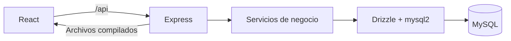

# Arquitectura

Monolito modular con React y Express en un único despliegue. No se incorporan servicios externos ni un frontend separado en producción.

El desarrollo usa Vite en 5173 y Express en 3000. La producción sirve `apps/web/dist` desde Express y utiliza el puerto asignado por el alojamiento.

Los servicios de negocio se agregarán por módulo en etapas posteriores. Solo el backend accederá a MySQL. `packages/shared` no puede contener configuración de base ni credenciales.

## Persistencia

- MySQL 8 o MariaDB 11.8.9/InnoDB, UTF-8 completo (`utf8mb4`).
- Pool limitado a cinco conexiones por proceso.
- `DECIMAL(18,2)` recibido como cadena; `BIGINT` preservado como bigint en Drizzle y como texto al transportarse por HTTP.
- Fechas comerciales separadas de instantes UTC de registro. La interfaz utilizará formatos argentinos.
- Migraciones explícitas, nunca sincronización automática del esquema al arrancar el servidor.
- Un bloqueo de migración evita dos ejecuciones simultáneas sobre el mismo servidor.
- MySQL no revierte todo el DDL de una migración fallida. Hacer backup antes de actualizar bases con datos e investigar la causa; no reintentar ciegamente ni borrar datos.

## Consultas de listados a demanda

Los ABM actuales y futuros que utilicen MasterPage comienzan sin consultar la grilla. Aplicar filtros o Actualizar solicita datos y habilita la paginación; volver a entrar al módulo restaura el estado sin búsqueda. Las escrituras refrescan la grilla únicamente si ya había sido solicitada, incluso cuando aquella consulta no tuvo coincidencias. DataTable permite distinguir el estado inicial, carga, resultado vacío y error mediante su mensaje configurable. Los módulos con listados propios deben conservar esta misma política. Las consultas de sesión, referencias y sugerencias de códigos siguen siendo independientes. Ver [navegación y carga manual](navegacion-abm.md#carga-manual-de-los-listados).

## Referencias en los listados

Los listados actuales y futuros deben mostrar el texto descriptivo de las entidades relacionadas cuando la columna representa una FK. Los códigos propios del registro siguen visibles y todas las relaciones, filtros y escrituras conservan sus identificadores internos. Las descripciones se obtienen desde su tabla de origen, sin almacenarlas nuevamente en el registro principal ni hacer una solicitud por fila desde la interfaz.

En los ABM compartidos, cada referencia visible declara `relationLabelField` en `masterDefinitions`. El backend resuelve las etiquetas en su consulta y MasterPage las presenta mediante el mapa `descripciones`. Clientes utiliza `CLIENTETIPO.Descripcion` y Cuentas bancarias utiliza `BANCO.Nombre`. La prueba de definiciones comprueba que las próximas relaciones de grilla también declaren un campo descriptivo válido. Los nuevos módulos con consultas propias deben mantener este mismo criterio y separar sus etiquetas de presentación de los datos utilizados para escribir. Ver [configuración y pruebas](ajustes-componentes.md#descripciones-de-relaciones-en-las-grillas).

## Configuración

Las variables del proceso prevalecen sobre `.env`. Express lee DB_HOST, DB_PORT, DB_NAME, DB_USER, DB_PASSWORD, DB_SSL y, opcionalmente, DB_SSL_CA_PATH. Con TLS se mantiene la verificación del certificado. No utilizar opciones que desactiven esa verificación.

Ninguna variable DB tiene prefijo `VITE_`: las variables de base no deben incorporarse al frontend. No hay contraseñas predeterminadas ni usuarios reales creados por el repositorio.

## Endpoints de esta etapa

- `GET /api/health`: el proceso de API responde.
- `GET /api/ready`: una consulta MySQL real funciona; devuelve 503 si falla. No expone credenciales, host ni errores internos. No sustituye la comprobación de migraciones.
- Las rutas de API inexistentes devuelven JSON 404, no el HTML de React.

Estos dos endpoints de disponibilidad son públicos y no exponen datos financieros. La etapa 2 agrega `POST /api/auth/login`, `GET /api/auth/me` y `POST /api/auth/logout`. El servidor consulta SESION, USUARIO y ROL; las sesiones duran ocho horas y se transportan en una cookie HttpOnly, Secure en producción y SameSite=Lax. No se habilita CORS ni se guardan credenciales en localStorage. Ver [etapa 2](etapa-2.md).

El límite de ingresos vive en memoria por proceso; reiniciar lo restablece. Sin confiar en encabezados de proxy arbitrarios, la dirección de conexión puede agrupar usuarios del mismo proxy. Si se escala a múltiples procesos, revisar límites compartidos y la topología del proxy.

La etapa 3 agrega `/api/maestros` para seis tablas existentes. Los servicios se organizan en rutas/validación y un repositorio que concentra SQL parametrizado, transacciones y auditoría. Los usuarios activos consultan; ADMIN puede escribir, con CSRF. El cliente comparte tabla, paginación, modal y formularios, y un único cliente HTTP. Ver [etapa 3](etapa-3.md). Los endpoints financieros se incorporan en la etapa 5.

## Comprobantes y Numeración

La etapa 4 amplía `/api/maestros` con `comprobantes` y `numeraciones`, manteniendo dos pantallas independientes. MasterDefinition configura opciones de enums compartidos, campos enteros y PK Codigo o IDTabla; MasterRecord conserva los nombres reales de los campos. Los enteros y BIGINT viajan como texto, con validación de rango sin pérdida de precisión. Los enums viven en `packages/shared/src/comprobantes.ts`, no son tipos ENUM de SQL.

NUMERACION usa la FK Comprobante y su índice único de comprobante–serie. Las modificaciones bloquean su fila y comprueban uso en CUENTACORRIENTE y CAJAMOVIMIENTO, incluidos anulados, antes de modificar o eliminar. Las futuras operaciones deberán usar ese mismo bloqueo y actualizar el correlativo dentro de su transacción de emisión. Configurar la numeración no emite ni consume números. Ver [alcance, reglas y pruebas](etapa-4.md).

## Cuenta corriente (etapa 5)

`current-account` separa validación, rutas y persistencia, y se integra en `/api/cuenta-corriente`. El frontend reutiliza controles y listados, agrega SearchField genérico y ClientSearch como adaptador. IDTabla no se muestra en las pantallas.

La numeración es opcional: sin Numerador se deriva el prefijo fijo 0000, sin agregar campos. Las altas bloquean el espacio de comprobante/prefijo mediante GET_LOCK antes de la transacción y comprueban duplicados, incluidos anulados y CAJAMOVIMIENTO; con Numerador bloquean y actualizan además su fila. Los reintentos usan SOLICITUD y la auditoría se confirma en la misma transacción. Las futuras escrituras financieras deben compartir el protocolo, bloquear las cuentas a afectar y no descontar dos veces cancelaciones. Ver [alcance y pruebas](etapa-5.md).

## Caja movimiento (etapa 6)

El módulo cash-movement agrega rutas/validación/persistencia e interfaz en /cobros-pagos. Reutiliza financialTransactions con el protocolo de numeración e idempotencia existente; Cuenta corriente conserva su aislamiento anterior y Caja movimiento usa READ COMMITTED junto con bloqueos de apertura, documentos e instrumentos. Las consultas de listados siguen siendo a demanda. Selección múltiple es una opción de DataTable y OffCanvas no conoce entidades.

ImporteACuenta conserva el importe original; las aplicaciones tienen fecha y usuario. CajaMovimientoOrigen vincula una reversión completa sin modificar la operación ni el cierre anteriores. Solo el efectivo afecta CAJASALDO. Los cheques conservan su identidad y eventos, y las transferencias generan un único movimiento bancario. Ver [alcance, migración y pruebas](etapa-6.md).
