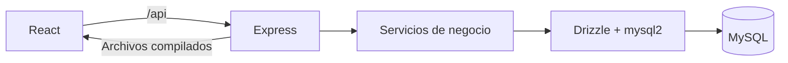

# Arquitectura

Monolito modular con React y Express en un único despliegue. No se incorporan servicios externos ni un frontend separado en producción.

El desarrollo usa Vite en 5173 y Express en 3000. La producción sirve `apps/web/dist` desde Express y utiliza el puerto asignado por el alojamiento.

Los servicios de negocio se agregarán por módulo en etapas posteriores. Solo el backend accederá a MySQL. `packages/shared` no puede contener configuración de base ni credenciales.

## Persistencia

- MySQL 8/InnoDB, UTF-8 completo (`utf8mb4`).
- Pool limitado a cinco conexiones por proceso.
- `DECIMAL(18,2)` recibido como cadena; `BIGINT` preservado como bigint en Drizzle y como texto al transportarse por HTTP.
- Fechas comerciales separadas de instantes UTC de registro. La interfaz utilizará formatos argentinos.
- Migraciones explícitas, nunca sincronización automática del esquema al arrancar el servidor.
- Un bloqueo de migración evita dos ejecuciones simultáneas sobre el mismo servidor.
- MySQL no revierte todo el DDL de una migración fallida. Hacer backup antes de actualizar bases con datos e investigar la causa; no reintentar ciegamente ni borrar datos.

## Configuración

Las variables del proceso prevalecen sobre `.env`. Express lee DB_HOST, DB_PORT, DB_NAME, DB_USER, DB_PASSWORD, DB_SSL y, opcionalmente, DB_SSL_CA_PATH. Con TLS se mantiene la verificación del certificado. No utilizar opciones que desactiven esa verificación.

Ninguna variable DB tiene prefijo `VITE_`: las variables de base no deben incorporarse al frontend. No hay contraseñas predeterminadas ni usuarios reales creados por el repositorio.

## Endpoints de esta etapa

- `GET /api/health`: el proceso de API responde.
- `GET /api/ready`: una consulta MySQL real funciona; devuelve 503 si falla. No expone credenciales, host ni errores internos. No sustituye la comprobación de migraciones.
- Las rutas de API inexistentes devuelven JSON 404, no el HTML de React.

Estos endpoints todavía no implementan autenticación ni operaciones de negocio. La etapa siguiente incorporará acceso, roles y layout; no publicar datos financieros antes de completar esa etapa.
