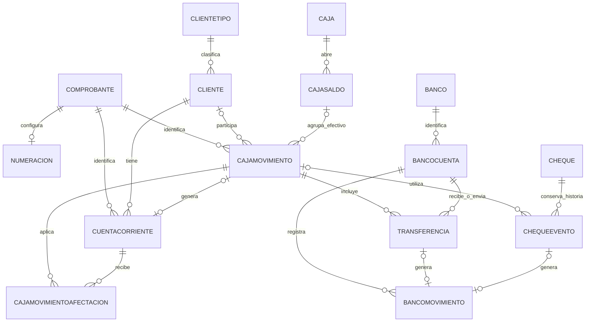

# Modelo de datos de referencia

Se conserva el diseño de 21 tablas acordado. La definición ejecutable está en `apps/api/src/database/schema.ts` y su historial en `database/migrations`. No hay datos de negocio precargados.

| Tabla | Finalidad y referencias |
|---|---|
| COMPROBANTE | Maestro de configuración, no cabecera de una operación |
| NUMERACION | Próximo número completo por Comprobante; configuración opcional y única |
| CLIENTETIPO | Clasificación comercial |
| CLIENTE | Cuenta comercial de un ClienteTipo |
| CONCEPTO | Motivos de ingresos, egresos y ajustes |
| CAJA | Caja física |
| CAJASALDO | Apertura y cierre de una Caja |
| CAJAMOVIMIENTO | Operación completa; Comprobante, número completo propio, Cliente, CajaSaldo y Concepto |
| CUENTACORRIENTE | Deuda o crédito; Cliente, Comprobante y CajaMovimiento cuando es generado |
| CAJAMOVIMIENTOAFECTACION | CajaMovimiento, CuentaCorriente e Importe |
| BANCO | Entidad financiera |
| BANCOCUENTA | Cuenta financiera propia de un Banco, incluida una billetera |
| CHEQUE | Identidad persistente del instrumento |
| CHEQUEEVENTO | Historia y participación en CajaMovimiento |
| TRANSFERENCIA | Transferencia concreta con FK directa a CajaMovimiento |
| BANCOMOVIMIENTO | Efecto bancario de Transferencia o ChequeEvento |
| ROL | Perfil de acceso |
| USUARIO | Usuario con un Rol |
| SESION | Sesión de un Usuario |
| AUDITORIA | Acciones y responsables |
| SOLICITUD | Claves para controlar reintentos |

El diagrama resume el circuito; las FK de usuarios y demás referencias se encuentran en el esquema. Las FK de CAJAMOVIMIENTOAFECTACION llevan nombres cortos porque MySQL limita los identificadores a 64 caracteres; no cambian los nombres de tablas o campos.

Importes de cheques y transferencias se obtienen desde sus participaciones y registros, no son columnas editables en la cabecera. Una operación puede contener varias transferencias con la misma FK CajaMovimiento. Reutilizar un cheque agrega un evento, no otro cheque.

Los premios se registrarán como deuda en PAGAR y se cancelarán mediante pagos y afectaciones. Un jugador no necesita convertirse en proveedor. El saldo de cuenta corriente y el pendiente por comprobante no se descuentan dos veces.

## Decisiones funcionales aún pendientes

No se implementan en esta etapa ni se resuelven agregando tablas por anticipado:

- Aplicación de créditos independientes contra deudas.
- Redistribución de afectaciones confirmadas conservando la historia.
- Correcciones posteriores a cierres y operaciones relacionadas.
- Tratamiento contable del rechazo de cheques.
- Autorización y registro de diferencias de caja.
- Circuito de aperturas y ajustes bancarios independientes.

La existencia de los campos de estado o anulación no significa que los servicios financieros ya estén implementados. Los ABM y las operaciones se incorporarán y probarán por etapas.

## Número de comprobante

NUMERACION.ProximoNumero y los campos NumeroComprobante de CUENTACORRIENTE y CAJAMOVIMIENTO almacenan el BIGINT compuesto. No hay FK de movimientos al Numerador ni Serie separada. La migración conserva los números anteriores y sus registros, y exige resolver incompatibilidades antes de convertirlos. Ver [reglas y procedimiento](numeracion-comprobantes.md).
